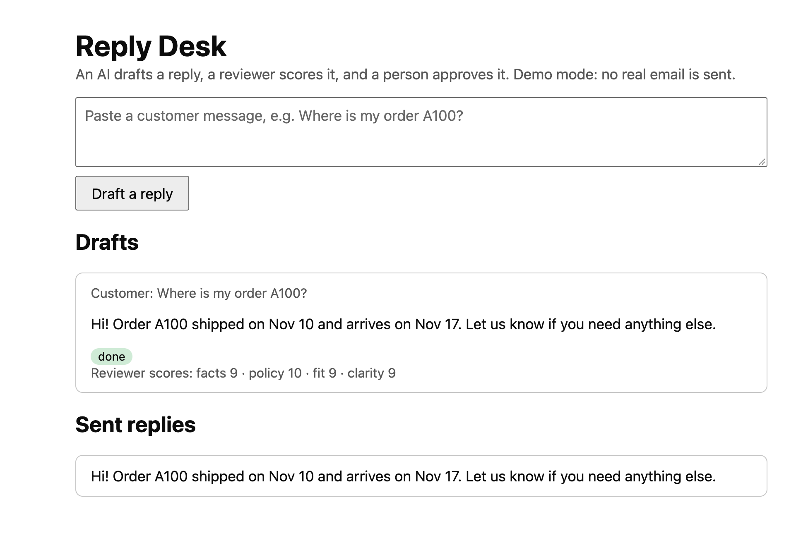
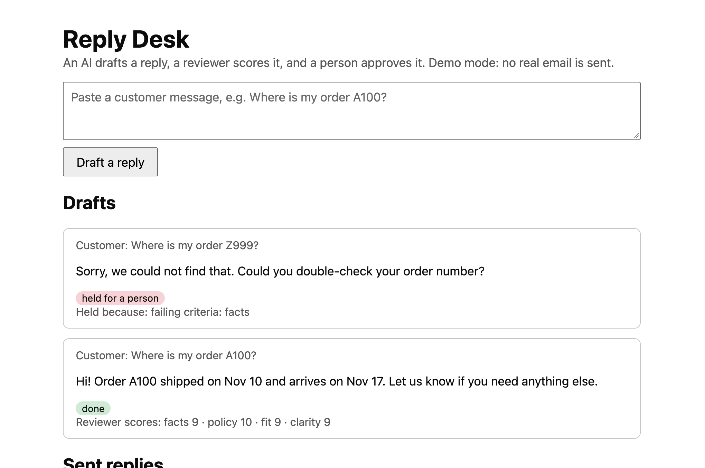
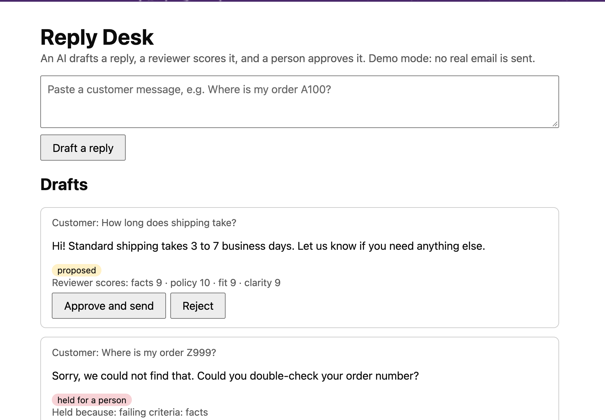
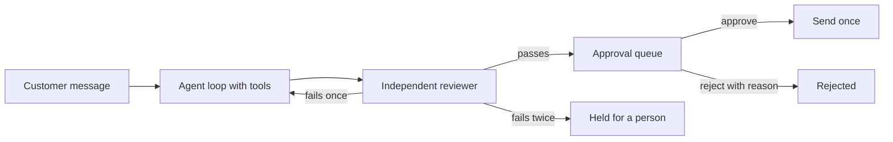

# Reply Desk

**An AI agent that drafts customer-support replies, has an independent reviewer score them, and waits for a human to approve before anything is "sent".**

Built as the capstone for the Homingo Learn course *Build and ship an AI agent + MCP server*.

**Live demo:** https://reply-desk-fj3z.onrender.com
(The free host sleeps when idle, so the first load can take about a minute.)

## Screenshots

| Approved and sent | Held for a person | Rejected with a reason |
|---|---|---|
|  |  |  |

## What it does

1. You paste a customer message, for example *"Where is my order A100?"*.
2. The agent calls tools (`lookup_order`, `search_faq`) and writes a draft reply.
3. An independent reviewer scores the draft on four criteria: facts, policy, fit and clarity.
4. If the draft fails review, it gets **one** rewrite using the reviewer's notes. If it still fails, it is **held for a person**.
5. A draft that passes waits in an approval queue. A person approves or rejects it.
6. Only an approved, unchanged draft is "sent", and it is sent exactly once.

In demo mode the model and reviewer are rule-based stand-ins, so **no API key and no cost** are needed. "Sending" only saves the reply to a list, and no real email is sent.

## Try it

| Message | What happens |
|---|---|
| `Where is my order A100?` | Drafted from order data, approved by the reviewer, waits for you to approve |
| `Where is my order Z999?` | No such order, so the reviewer holds it for a person |
| `How long does shipping take?` | Answered from the FAQ |

## How it works



## Safety features

- **Bounded agent loop:** step limit, token budget, repeated-call detection, and tool errors become error results instead of crashes.
- **Independent reviewer:** it sees only the draft, the rubric and the sources, never the writer's reasoning. A malformed review counts as a failure (fail closed).
- **Human approval is enforced in code**, not in a prompt. The approval is tied to a hash of the exact text, so an edited draft needs a fresh approval.
- **Exactly-once sending:** an idempotency key means a repeated click or retry cannot send twice.
- **Startup checks:** production refuses to start with debug on or unsafe settings, and lists every problem without printing any secret.
- **No secrets in the repo:** `.env` is git-ignored, and the full git history was scanned before the repo was made public.

## Project structure

```
reply-desk/
├── main.py            FastAPI app and routes
├── service.py         Ties the agent, reviewer and approval queue together
├── agent.py           Bounded agent loop, tools and fake model
├── reviewer.py        Rubric, review checks and the QA gate
├── approvals.py       Approval queue with hash check and one-time execution
├── settings.py        Startup checks for configuration
├── static/index.html  Simple web page
├── Screenshots/       Images used in this README
├── try_*.py           Small scripts that test each part in the terminal
└── requirements.txt
```

## Run locally

```bash
git clone https://github.com/Annu9111/reply-desk.git
cd reply-desk
python3 -m venv .venv
source .venv/bin/activate
pip install -r requirements.txt
uvicorn main:app --reload
```

Open http://127.0.0.1:8000. API docs are at http://127.0.0.1:8000/docs.

To test each part on its own:

```bash
python try_agent.py
python try_reviewer.py
python try_queue.py
```

## Configuration

| Variable | Default | Notes |
|---|---|---|
| `APP_ENV` | `development` | `development` or `production` |
| `DEBUG` | off | must be off in production |
| `DEMO_MODE` | `true` | no API key needed in demo mode |
| `ANTHROPIC_API_KEY` | none | only required when `DEMO_MODE` is off |
| `ALLOWED_ORIGINS` | none | required in production and must not contain `*` |

Never commit a `.env` file or any API key.

## Limitations

- Drafts and sent replies are kept in memory and reset when the server restarts or sleeps.
- Demo mode uses rule-based stand-ins for the model and reviewer.
- It does not send real email.

## What I would build next

- Connect a real model behind the same loop, with the reviewer on a separate model.
- Store drafts and the audit log in a database.
- Expose the tools through an MCP server.
- Add a heartbeat alert and a PAUSE switch for scheduled runs.

## License

MIT. See [LICENSE](LICENSE).
